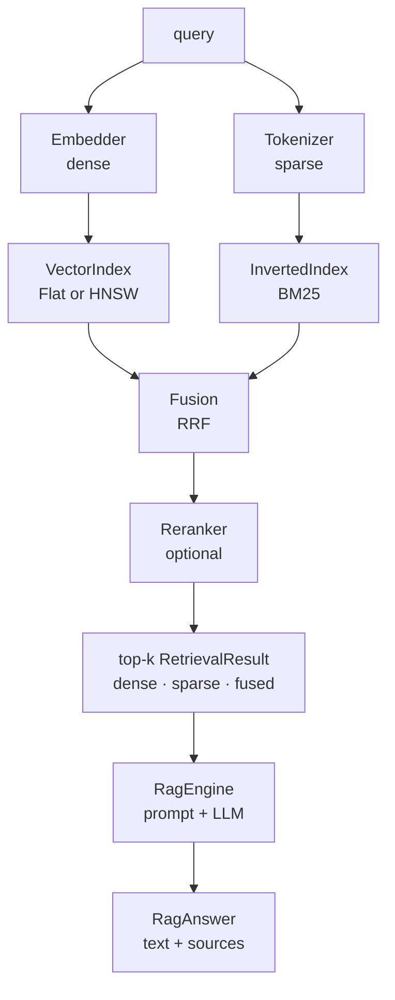

<p align="center">
  <em>Dense plus sparse retrieval, fused and re-ranked, with a RAG pipeline on top — all on the JDK.</em>
</p>

<p align="center">
  
  
  
</p>

---

Hybrid retrieval means running two indexes over the same documents — one on
vectors, one on terms — and fusing their rankings. Halo implements both, the
fusion, a re-ranker, and a RAG loop, with no external dependencies.

## Quick start

```java
Collection kb = new Collection("engineering-notes", new HashEmbedder(1024));
for (Document d : SAMPLE_DOCS) kb.add(d);

String question = "How does garbage collection work in the JVM?";
List<RetrievalResult> hits = kb.search(question, 3);

for (RetrievalResult r : hits) {
    System.out.printf("%-12s dense=%.3f sparse=%.3f fused=%.3f%n",
            r.id(), r.denseScore(), r.sparseScore(), r.score());
}
```

```bash
javac -d build $(find src/main/java -name '*.java')
java -cp build halo.examples.Demo     # 全离线
```

## Retrieval-augmented generation

```java
RagEngine rag = new RagEngine(kb, new StubLlm());   // 换成你的 LLM 客户端
RagAnswer answer = rag.ask("How does garbage collection work in the JVM?");
System.out.println(answer.text());
System.out.println(answer.sources());              // 命中的文档 id
```

`setTopK(n)` 控制送进 prompt 的文档数。

## The pieces

| Layer | Classes |
|---|---|
| Embedding | `HashEmbedder` · `BagOfWordsEmbedder` · `NgramEmbedder` · `TfIdfEmbedder` |
| Vector index | `FlatIndex` (exact) · `HnswIndex` (approximate, `setEfSearch`) |
| Lexical index | `InvertedIndex` |
| Fusion | `HybridIndex` — `add` · `search` · `searchDetailed` → `FusedHit` |
| Re-ranking | `Reranker` · `FeatureReranker` |
| RAG | `RagEngine` · `RagAnswer` · `StubLlm` |
| Evaluation | `Evaluator.evaluate(...)` → `Evaluator.Metrics` (nested) |

## How a query flows



Why two indexes: dense vectors catch paraphrase, term matching catches exact
identifiers, error codes and product names that embeddings blur. Fusing the two
rankings is what makes either one's weakness survivable.

## Install

Plain Java source — copy `src/main/java/halo` into your module. JDK 21+, nothing
else on the classpath.

## Tests

```bash
java -jar junit-platform-console-standalone-1.10.2.jar --class-path build --scan-class-path
```

43 JUnit 5 cases.

## Limitations

- **`HashEmbedder` is a hashing bag-of-words, not a semantic model.** It rewards
  vocabulary overlap and cannot tell "the drug is safe" from "the drug is not safe".
  It exists so the pipeline runs offline; real recall needs a real embedding model.
- **BM25 is implemented here, not Lucene's.** No field boosts, no phrase queries, no
  analyzers beyond the ones in `Tokenizers`.
- **RRF fusion is rank-based, so scores are not comparable across queries.** Use the
  ranking, not the fused number, as a threshold.
- **The HNSW graph is in-memory only.** No persistence, no incremental delete.
- **No published benchmark numbers.** Recall and latency figures are not measured in
  the repo, so none are claimed here.

## License

MIT
